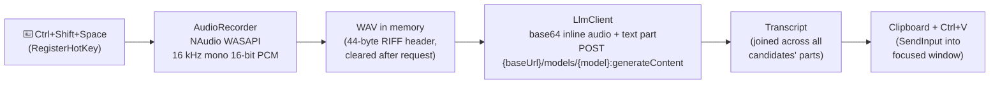
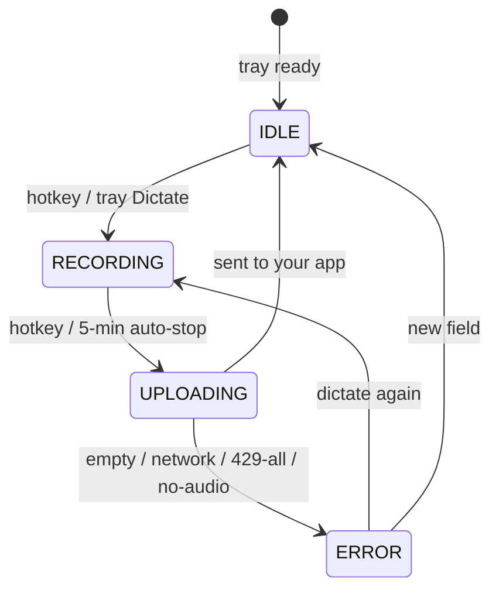

<div align="center">

# 🎙️ Voice IME for Windows

**System-wide voice dictation. Press Ctrl+Shift+Space and talk — anywhere.**

A tray-first Windows app: global hotkey → record → transcribe with Gemini →
paste into the focused window. The Windows sibling of
[voice-ime-android](https://github.com/arvindg4u/voice-ime-android) — same
core architecture, native C# port.

[](https://github.com/arvindg4u/voice-ime-windows/actions/workflows/windows.yml)
[](https://github.com/arvindg4u/voice-ime-windows/releases)
[](https://www.microsoft.com/windows)
[](https://dotnet.microsoft.com)
[](https://learn.microsoft.com/dotnet/csharp)
[](LICENSE)

[Features](#-features) · [Quick start](#-quick-start) · [How it works](#-how-it-works) · [Architecture](#-architecture) · [Privacy](#-privacy--security)

</div>

---

<!--
  DEMO — replace the placeholder below with a short screen recording.

  Record with ScreenToGif (free, Windows): https://www.screentogif.com/
  Keep it under ~10 s and show the whole loop, because the value is only
  obvious when seen:
    1. focus a text field (Notepad or a browser)
    2. press Ctrl+Shift+Space — the pill appears with the live transcript
       rolling in as you speak
    3. press it again — the text lands in the field

  Export as GIF (small, autoplays in the README) to docs/demo.gif, then swap
  the block for:
      

  A GIF is worth more here than any feature list: it shows the three things a
  reader cannot infer from prose — the hotkey, the live preview, and that text
  really does land in the app they are already using.
-->
<p align="center">
  <em>📹 Demo GIF goes here — see the comment above <code>docs/demo.gif</code></em>
</p>

---


## Table of contents

- [Why a Windows twin](#why-a-windows-twin)
- [✨ Features](#-features)
- [🚀 Quick start](#-quick-start)
- [⚙️ Configuration](#-configuration)
- [🔄 Key rotation](#-key-rotation)
- [💬 Custom prompt](#-custom-prompt)
- [🧠 How it works](#-how-it-works)
- [🏗️ Architecture](#-architecture)
- [🛠️ Build from source](#-build-from-source)
- [✅ Testing](#-testing)
- [📏 Limits](#-limits)
- [🔒 Privacy & security](#-privacy--security)
  - [Where your audio goes](#where-your-audio-goes)
- [❓ FAQ & troubleshooting](#-faq--troubleshooting)
- [🤝 Contributing](#-contributing)
- [🙏 Acknowledgments](#-acknowledgments)

---

## Why a Windows twin

Windows has no IME slot for a voice-only keyboard — but it has something
better for dictation: a **global hotkey that works in every app**. Voice IME
for Windows keeps the Android core (record 16 kHz WAV → Gemini
`generateContent` → deliver transcript) and swaps only the platform edges:

| Android | Windows |
| ------- | ------- |
| `InputMethodService` mic tap | Global hotkey **Ctrl+Shift+Space** from any app |
| `AudioRecord` | NAudio capture (16 kHz requested from the OS mixer) |
| `commitText` into editor | Clipboard + synthesized **Ctrl+V** into focused window |
| `EncryptedSharedPreferences` | DPAPI (`ProtectedData`, CurrentUser scope) |
| Material 3 IME view | Tray icon + WPF settings/history windows |
| Debug APK from CI | Single-file `VoiceIme.exe` from CI |

> **Thirty-second pitch:** run `VoiceIme.exe`, paste a Gemini API key, press
> **Ctrl+Shift+Space** in any text field — then talk.

---

## ✨ Features

- **Works everywhere** — global hotkey fires from browsers, Office, editors,
  chat apps: anywhere with a text field.
- **Tray-first** — `NotifyIcon` owns the lifecycle: Dictate / Settings /
  History / Quit. No window clutter.
- **Live streaming models** — model names containing `-live`, `native-audio`
  or `-dialog` stream over a WebSocket (`bidiGenerateContent`) instead of
  buffering: you see interim text in the pill while you are still speaking, and
  the final lands faster. Everything else uses the REST path. Nothing to
  configure — the model name selects the transport.
- **Voice pipeline** — 16 kHz mono 16-bit PCM → in-memory WAV → Gemini
  `generateContent` with base64 inline audio.
- **Clipboard + Ctrl+V delivery** — transcript lands in the focused window;
  your previous clipboard is restored afterwards.
- **Multi-key rotation** — round-robin across keys with automatic 429
  failover and even load spread (identical semantics to Android).
- **User-shaped transcription** — custom system prompt (≤ 2000 chars) steers
  formatting, language, tone — including the Test button.
- **Clipboard history** — every transcript saved to `%AppData%` (cap 100,
  pinned survive eviction); pin / delete / clear-unpinned.
- **Test button** — sends a 1-second 440 Hz tone through the full pipeline to
  verify keys/model/prompt before dictating.
- **Live preview in the pill** — while recording, the interim transcript
  scrolls in the floating pill as you speak: new words appear on the right,
  old ones fade off the left, settled text is solid and the provisional guess
  is dimmed. (Live models only.)
- **Accessible** — visible keyboard focus on every control, AA contrast in both
  light and dark themes (verified by tests), Windows High Contrast support, and
  screen-reader announcements for recording/transcribing/errors.
- **Light, dark and system themes** — follows Windows and updates live.
- **State in the tray** — tooltip + balloon tips mirror
  idle → recording → transcribing → sent/error.
- **Resilient recording** — hotkey toggles start/stop, 5-min auto-stop, mic
  teardown off the UI thread.

---

## 🚀 Quick start

**You need:** Windows 10 (1809+) or 11 (x64) and a
[Gemini API key](https://aistudio.google.com/apikey). No admin rights needed.

**Option A — Installer (recommended):**

```text
1. Open Releases → download VoiceIme-Setup-<version>.exe
   https://github.com/arvindg4u/voice-ime-windows/releases
2. Run it — installs per-user (no admin), adds a Start-menu entry
   and an uninstaller. Launches Voice IME when done.
3. The settings window opens on launch. Paste Base URL / API keys /
   Model in the Gemini section → Save → Test.
4. Focus any text field, press Ctrl+Shift+Space, talk, press it again.
```

**Option B — Portable EXE:**

```text
1. Open Releases → download VoiceIme.exe
   (or Actions → latest Windows run → Artifacts → voice-ime-windows)
2. Run VoiceIme.exe — the settings window opens and the mic icon
   appears in the system tray.
```

> **Windows SmartScreen:** an unsigned download may show "Windows protected
> your PC" — click **More info → Run anyway**. If nothing at all appears,
> check `%AppData%\VoiceIme\logs\voiceime.log` and the tray overflow (the
> `^` chevron next to the clock).

> **Launch at sign-in:** Settings → **Advanced → Autostart**. The app
> creates/removes the Startup shortcut itself (started this way it stays in
> the tray via `--hidden`). To start tray-only every time, enable
> **Start hidden**; run `VoiceIme.exe --hidden` for a one-off tray launch.

---

## ⚙️ Configuration

Settings persist to `%AppData%/VoiceIme/settings.json`. API keys are
DPAPI-encrypted at rest and never logged.

| Field | Default / example | What it does |
| ----- | ----------------- | ------------ |
| **Base URL** | `https://generativelanguage.googleapis.com/v1beta` | Gemini-compatible endpoint. Swap for a proxy without rebuilding. |
| **API keys** | one key per line | Round-robin pool with 429 failover (see below). |
| **Model** | `gemini-2.5-flash` | REST: appended as `{baseUrl}/models/{model}:generateContent`. A Live model name (`-live` / `native-audio` / `-dialog`) switches to the WebSocket streaming path instead — see [Features](#-features). |
| **Custom prompt** | blank (disabled) | System instructions (max 2000 chars) under a *"User preferences:"* heading on every request, including Test. |

---

## 🔄 Key rotation

Identical to Android — load spreads instead of hammering key #1:

```text
keys = [k1, k2, k3], cursor starts at 0
request → try k1 → 429? → try k2 → success → cursor = (1 + 1) % 3 = 2
next request starts at k3 …
all keys 429'd → "Rate limited on all keys — retry later"
401 / other non-429 → fail immediately (never burns the other keys)
```

---

## 💬 Custom prompt

| Goal | Prompt to paste |
| ---- | --------------- |
| Formatting | `Add punctuation and paragraph breaks.` |
| Hinglish keep-as-is | `Keep Hinglish words as-is, don't translate them.` |
| Hindi script | `Reply in Hindi script (Devanagari).` |

---

## 🧠 How it works

### Pipeline



### State machine



---

## 🏗️ Architecture

**Stack:** C# 12 · .NET 8 (Windows) · WPF + WinForms tray · NAudio · xUnit ·
single-file self-contained `win-x64` EXE.

```text
src/VoiceIme/                      # WPF WinExe, net8.0-windows
├── App.xaml(.cs)                  # tray lifecycle, hotkey wiring, orchestration
├── HotkeyWindow.cs                # message-only window owning RegisterHotKey
├── AudioRecorder.cs               # WASAPI capture → WAV, levels, 5-min cap
├── LlmClient.cs                   # REST transcription + key rotation
├── NativeInput.cs                 # RegisterHotKey + clipboard/Ctrl+V via SendInput
├── SettingsStore.cs               # DPAPI-encrypted settings (%AppData%)
├── ClipboardStore.cs              # transcript history (cap 100, pin survives)
├── SettingsWindow.xaml(.cs)       # settings form + Test button
└── HistoryWindow.xaml(.cs)        # history list (copy / pin / delete)

tests/VoiceIme.Tests/              # xUnit + RichardSzalay.MockHttp
├── AudioRecorderTests.cs          # WAV header, test tone, magnitude, silence
├── LlmClientTests.cs              # success, 429 rotation, 429-all, 401, parsing
├── ClipboardStoreTests.cs         # ordering, eviction, pins, delete
└── SettingsStoreTests.cs          # DPAPI round-trip, no plaintext on disk
```

**Android mapping** (same core, different edges): `AudioRecorder`→NAudio,
`LlmClient`→`HttpClient` + same rotation, `commitText`→clipboard+Ctrl+V,
`EncryptedSharedPreferences`→DPAPI, `IME view`→tray+WPF, `gradlew`→`dotnet`.

**CI/CD** (`.github/workflows/`): `windows.yml` runs `dotnet test` + publishes
the single-file EXE on every push/PR; `release.yml` attaches `VoiceIme.exe`
to the GitHub Release on `v*` tags. Nothing is ever built locally.

---

## 🛠️ Build from source

```powershell
# Requirements: .NET 8 SDK (Windows)

git clone https://github.com/arvindg4u/voice-ime-windows
cd voice-ime-windows

# Tests (must stay green)
dotnet test VoiceIme.Windows.sln -c Release

# Single-file EXE → publish/VoiceIme.exe
dotnet publish src/VoiceIme/VoiceIme.csproj -c Release -r win-x64 --self-contained `
  /p:PublishSingleFile=true /p:IncludeNativeLibrariesForSelfExtract=true -o publish

# Installer → installer/Output/VoiceIme-Setup-<version>.exe (needs Inno Setup 6)
& "${env:ProgramFiles(x86)}\Inno Setup 6\ISCC.exe" installer\VoiceIme.iss
```

> You don't need to — CI builds the EXE on every push. This is for contributors.

---

## ✅ Testing

| Layer | How |
| ----- | --- |
| Unit | `dotnet test` — WAV encoding, key rotation (mock HTTP incl. 429/401), eviction/pins, DPAPI round-trip |
| Manual Test button | Settings → **Test** sends the 440 Hz tone end-to-end |
| Manual flows | dictate into Notepad → paste · no-key error · all-429 error · airplane-mode retry · 5-min auto-stop · elevated-app limitation |

> **Linux note:** this is a Windows GUI app (`net8.0-windows`, WPF). On
> Linux only what is OS-independent can be tested — `dotnet build` proves
> compile (via `EnableWindowsTargeting`), and STA view tests construct real
> WPF controls, so they pass vacuously with no window station (see
> `StaTestHelper`/`WpfStaCollection`). Full GUI-level coverage runs only on
> windows-latest CI (`.github/workflows/windows.yml` → `dotnet test`).

---

## 📏 Limits

- **Recording cap: 5 min** — same math as Android (≈13 MB request JSON, under
  the 20 MB inline-audio ceiling).
- **Network-bound** — offline shows an explicit error with retry.
- **Elevated windows excluded** — `SendInput` Ctrl+V can't reach apps running
  as Administrator unless Voice IME also runs elevated. Clipboard history still
  captures the transcript, so nothing is lost.
- **Windows-only** — x64, Windows 10+. An ARM64 build is wanted but not built
  yet; it needs a `win-arm64` publish leg (see
  [Contributing](#-contributing)) and runs under emulation until then.

---

## 🔒 Privacy & security

- **Audio is never written to disk** — recordings live in RAM and are zeroed
  after each request. What *is* persisted locally: your settings (keys
  encrypted) and transcript history in `%AppData%\VoiceIme\clips.json`, which
  is **plain text** — clear it from History or lower the cap in Settings.
- **Audio does leave your machine** — it is sent to the Gemini API to be
  transcribed. What happens to it there depends on your API tier: see
  [Where your audio goes](#where-your-audio-goes).
- **DPAPI-encrypted keys** — `ProtectedData` CurrentUser scope; the settings
  file contains only ciphertext. Keys never logged.
- **Minimal surface** — no admin rights, no background services, no telemetry.
  The installer is a convenience (per-user, uninstallable); the portable EXE
  needs none. Autostart is opt-in and just a shortcut you can remove.
- **Network egress** — only to your configured Base URL, and only while
  transcribing. Nothing else phones home.
- **Explicit consent** — Windows mic permission prompt at first capture.

### Where your audio goes

Voice IME has no server of its own — the only egress is your configured Base URL
(Google's Gemini API by default), and only while transcribing.

**What Google does with it depends on your API tier** ([Gemini API Additional
Terms](https://ai.google.dev/gemini-api/terms), effective 2026-03-23 — check that
page, these terms change):

| Your key | Google's use of your audio and transcript |
| --- | --- |
| **Free tier** — an AI Studio key with no billing account | Used "to provide, improve, and develop Google products and services and machine learning technologies". Human reviewers may read, annotate and process your input and output. Google's own guidance: *"Do not submit sensitive, confidential, or personal information to the Unpaid Services."* |
| **Paid tier** — a Cloud project with billing enabled | Not used to improve Google products. Still logged for a limited period to detect abuse and policy violations, and may be cached transiently. |

**Practical advice:** if you dictate anything confidential — work notes, messages,
anything with personal data — use a billing-enabled key, or don't dictate it. On
the free tier, treat every utterance as potentially read by a human reviewer.

> **The free tier is not for apps you hand to other people.** Google's terms say
> you "may use only Paid Services when making API Clients available to users in
> the European Economic Area, Switzerland, or the United Kingdom." If you fork
> this and ship it to others in those regions, you need billing enabled.

> Found a vulnerability? Please open a **private security advisory** on GitHub
> instead of a public issue.

---

## ❓ FAQ & troubleshooting

<details>
<summary><strong>"No API key — open Settings"</strong></summary>

The key pool is empty. Tray → Settings… → paste at least one key → Save → Test.
</details>

<details>
<summary><strong>"Rate limited on all keys — retry later"</strong></summary>

Every key returned 429. Wait a minute or add a key from another project. A 401
fails fast instead — check that key.
</details>

<details>
<summary><strong>Live model errors ("Model not available for Live", "Live setup rejected", "Network error")</strong></summary>

Live (`-live` / `native-audio` / `-dialog`) models stream over a WebSocket.
The Gemini endpoint reports most setup problems by closing that socket with a
reason, which Voice IME maps to a typed message:

- **Model not available for Live — check Settings** — the model name isn't
  served by `v1beta` `bidiGenerateContent` (typo, retired preview name, or
  regional availability). Switch to a current Live model in Settings.
- **Live setup rejected by server — check model in Settings** — the server
  rejected the session config for this model.
- **Invalid API key / Rate limited** — same meaning as the REST path; rate
  limits rotate to your next key automatically before any audio is sent.
- **Network error — check connection** — a genuine transport drop (no HTTP
  status, no close reason): firewall/proxy blocking `wss://`, captive portal,
  or offline.

Every Live connection writes a key-free `live-wire` trail to
`%AppData%\VoiceIme\logs\voiceime.log` — the exact server close code and
reason are logged there verbatim for diagnosis.
</details>

<details>
<summary><strong>Paste doesn't land in the app</strong></summary>

Click the text field first, then dictate. Windows will not let an app send
keystrokes to a window running at a higher privilege level than itself
(UIPI). If the target runs as Administrator, either relaunch Voice IME as
administrator too, or copy the transcript from History. The toast names the
reason because this failure is silent at the API level: Windows reports the
keystroke as sent and then drops it, so there is no error code to quote.

Voice IME waits briefly for you to lift the hotkey keys before sending the
paste chord (held modifiers would turn Ctrl+V into e.g. Ctrl+Alt+V), retries
around Windows 11's clipboard-history service when the clipboard is busy,
and restores your previous clipboard text about a second after the paste —
unless you copied something else in the meantime, in which case your copy is
left alone.

Every delivery failure keeps the transcript in History, leaves it on the
clipboard so you can paste it yourself, and writes a `paste:` diagnostic line
to `%AppData%\VoiceIme\logs\voiceime.log` recording the classified reason.
</details>

<details>
<summary><strong>Hotkey does nothing</strong></summary>

Another app may have claimed Ctrl+Shift+Space. Close overlays/clipboard
managers and retry. Tray → Dictate always works as a fallback.
</details>

<details>
<summary><strong>"No speech detected" / empty transcript</strong></summary>

Speak closer/louder, check Windows mic input level, and make the recording
longer than ~0.5 s.
</details>

---

## 🤝 Contributing

```powershell
dotnet test VoiceIme.Windows.sln -c Release   # must stay green
```

- **Issues:** Windows version, app version, model, exact tray/toast message.
- **PRs:** keep the tray-first concept; add/update xUnit tests for logic;
  keep functions focused and errors explicit.
- **No-goes:** background services, disk persistence of audio (RAM only),
  unencrypted key storage, new network endpoints without discussion. An
  installer already exists (`installer/VoiceIme.iss`) — keeping it working is
  fine; adding *new* install-time components/scheduled tasks is not.
- **Wanted, not yet built** — these are good first issues:
  - **Push-to-talk** — `ActivationModes` already declares
    `push_to_talk`/`hold_or_toggle`, but every mode currently behaves as
    toggle. The parser and settings round-trip exist; the coordinator is where
    hold-detection lands.
  - **`win-arm64`** — add a publish leg next to `win-x64` in both workflows and
    an ARM64 artifact. Nothing in the code assumes x64 except the published
    RID.
  - **Offline fallback** — a local model (e.g. whisper.cpp) behind the same
    `ITranscriptionTransport` seam, so dictation survives with no network.

---

## 🙏 Acknowledgments

Core architecture ported from
[voice-ime-android](https://github.com/arvindg4u/voice-ime-android) (same
author). Transcription by the [Gemini API](https://ai.google.dev). Audio via
[NAudio](https://github.com/naudio/NAudio).
